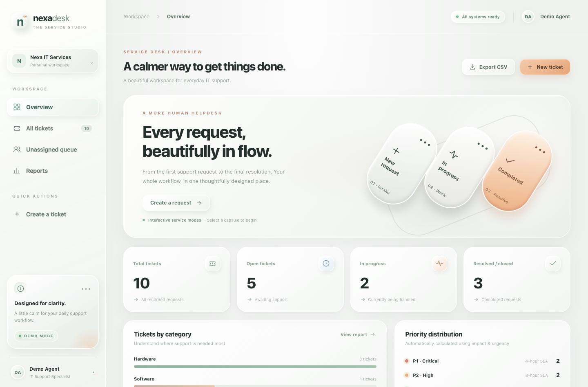

# NexaDesk Glass · IT Helpdesk & Ticket Management

<!-- BEGIN: SUPPORT SCENARIOS / IT SUPPORT EVIDENCE -->

## IT Support scenarios / Praxisfälle / Destek senaryoları

**[Read the step-by-step scenarios](docs/SUPPORT_SCENARIOS.md)** — Ticket triage: Wi-Fi / DHCP incident and priority handling.

**DE:** Praxisfälle: Ticketpriorisierung, Zuweisung und Dokumentation. · **TR:** Örnek destek vakaları; belirtiler, kontrol adımları ve test kanıtları.

> These are **fictional, reproducible portfolio scenarios**, not real client incidents.

<!-- END: SUPPORT SCENARIOS / IT SUPPORT EVIDENCE -->


<!-- BEGIN: REAL APPLICATION PREVIEW -->

## Interface preview / Benutzeroberfläche



> Screenshot captured from the **running application with fictional/demo data**. This is a locally hosted portfolio demo, not a production deployment. / *Echter Screenshot aus der lokal gestarteten Demo mit Beispieldaten.*

<!-- END: REAL APPLICATION PREVIEW -->

<!-- BEGIN: INTERNATIONAL PORTFOLIO SUMMARY -->

[](https://github.com/muratpalak/IT-Helpdesk-Ticket-Management/actions/workflows/tests.yml)

**International portfolio overview / Internationale Projektübersicht**

**EN:** Local helpdesk demo covering ticket intake, priority matrix, assignment, status transitions and CSV export. **Tech:** FastAPI · SQLite · JavaScript · Ticket workflow. This is a portfolio/demo project; read its limitations before real-world use.

**DE:** Lokales Service-Desk-Demo mit Ticketaufnahme, Priorisierung, Zuweisung, Statusworkflow und CSV-Export.

**[Technical case study / Technische Projektbeschreibung](docs/PORTFOLIO_CASE_STUDY.md)** · [Automated checks](https://github.com/muratpalak/IT-Helpdesk-Ticket-Management/actions/workflows/tests.yml)

<!-- END: INTERNATIONAL PORTFOLIO SUMMARY -->


A functional, locally hosted service desk portfolio demo with an elegant frosted-glass interface. Version 2.0 takes visual inspiration from softly lit physical controls: ceramic surfaces, floating oval action buttons, tactile segmented filters, calm neutral tones, and warm peach highlights.

## What works

- Ticket creation with subject, requester, category, impact, urgency, and technician
- Automatic P1–P4 priority calculation and illustrative SLA target deadlines
- State workflow: **Open → In progress → Resolved → Closed**, plus reopening
- Assignment, impact/urgency changes, mandatory resolution notes and append-only activity log
- Filterable/searchable ticket list, active/completed views, reports, and CSV export
- Responsive interface and ten fictional initial tickets; changes persist in SQLite

## Run on macOS

Unzip the project, then move the folder to your Desktop and run:

```bash
cd "$HOME/Desktop/IT-Helpdesk-Ticket-Management-Glass-v2"
chmod +x START_MAC.command
./START_MAC.command
```

The launcher creates a Python virtual environment if needed, installs dependencies, starts a local server, and opens **http://127.0.0.1:8000** (or the next available port up to 8009). Press **Ctrl+C** to stop. The command always changes to its own folder internally, so you do not need to run `pip install` manually.

If you extracted the directory into Downloads, replace `Desktop` with `Downloads` in the `cd` command.

### Alternative manual startup

```bash
python3 -m venv .venv
source .venv/bin/activate
python3 -m pip install -r requirements.txt
python3 -m uvicorn app:app --host 127.0.0.1 --port 8000
```

## Architecture

- **Backend:** Python / FastAPI / Pydantic
- **Persistence:** SQLite with ticket and event tables
- **Frontend:** HTML, CSS, vanilla JavaScript, no front-end build tooling
- **Tests:** Pytest + FastAPI TestClient (`python3 -m pip install pytest httpx` then `python3 -m pytest -q`)

The app is intentionally **local-only**, without user authentication or role-based access; it must not be used with real customer or employee data or deployed publicly without adding security controls. SLA values are illustrative calendar-hour targets, not contractual SLAs.

See [Türkçe rehber](README_TR.md) and [German project description](docs/PROJECT_OVERVIEW_DE.md).
