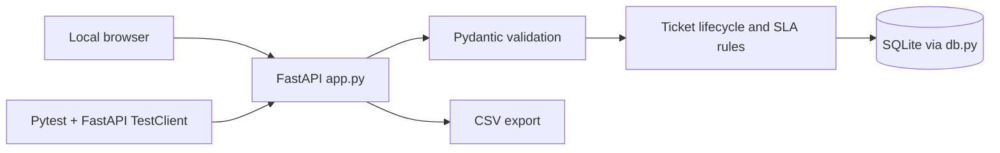

# Architecture — NexaDesk Glass

**Status:** local portfolio application using fictional records; **not** a production service desk.

## Boundaries and code map

| Layer | Implementation | Responsibility |
| --- | --- | --- |
| Presentation | `static/index.html`, `static/styles.css`, `static/app.js` | Dashboard and user actions |
| REST API | `app.py` | Ticket CRUD-like actions, search, notes, lifecycle, dashboard, CSV |
| Input validation | FastAPI / Pydantic models in `app.py` | Field types, approved categories, priorities and assignees |
| Business rules | `db.py` and `app.py` | Impact + urgency → P1–P4, illustrative SLA, authorised state changes |
| Persistence | `db.py` with SQLite | Tickets, audit-like event history, deterministic fictional seed |
| Tests | `tests/test_app.py`, `tests/test_recruiter_regressions.py` | Automated API, rules and error-path checks |

## Concrete user flow

1. Local browser POSTs the ticket form to `/api/tickets`.
2. Pydantic validates fields; `priority_for()` calculates P1–P4 based on impact and urgency.
3. SQLite stores the ticket and creation event, including an illustrative target time.
4. Assignment and state transitions are validated. Invalid workflow steps return client errors rather than silently changing the state.
5. Notes/events preserve the resolution trail; `/api/export.csv` exports fictional ticket records.

## Operational limitations

- No user authentication, role-based access control, email notifications or production-grade audit trail.
- The illustrative SLA is based on elapsed calendar hours; it does **not** implement contractual business calendars.
- Use localhost only and fictional inputs; do not upload or share real customer support tickets.
- Passing CI confirms covered scenarios, not every deployment or security requirement.

## Deutsche Einordnung

Lokaler Beispiel-Service-Desk mit FastAPI, Validierung, Prioritätsberechnung, Statusworkflow, SQLite und Tests. **Keine produktive Mehrbenutzerlösung.**
